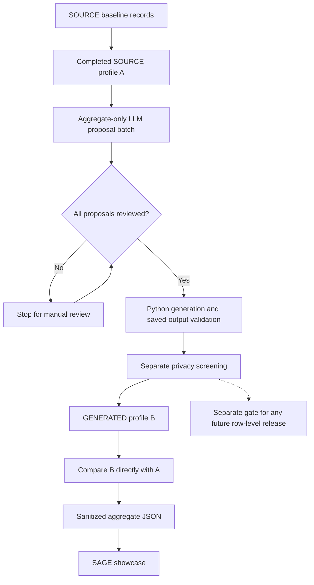

# SAGE: How the synthetic banking cohort is generated

SAGE generates a new banking population from measured SOURCE statistics using predefined Python logic. The LLM proposes which dependencies should be preserved; human review and the controlled registry determine which proposals can affect generation. The generated population is then checked, re-profiled and compared with the same SOURCE baseline.

This document describes the implementation reviewed on November 20, 2026. It does not report a newly executed cohort or claim that every supported rule was applied to a particular dataset.

## 1. Establish one SOURCE baseline

The optional [fake-input script](../scripts/Scotia%20Fake%20Records.py) creates the initial development records from a schema workbook and manually defined banking assumptions. Those records become the baseline that SAGE profiles.

There are therefore two distinct populations:

| Population | Purpose |
| --- | --- |
| Initial fake development records | Supply the SOURCE baseline for testing the pipeline |
| New synthetic cohort | Generated from the baseline's aggregate profiles |

`SOURCE` describes the population's role in the pipeline; it does not mean the records came from production.

Notebook 01 explicitly profiles either SOURCE or GENERATED inputs. SOURCE mode loads the development Parquet files into `workspace.default`; generated outputs use `workspace.synthetic_generated`. Profiling history is stored separately under `workspace.synthetic_profile`.

Downstream stages use one completed SOURCE run. In the workflow, its exact `source_run_id` is passed between tasks. Interactive execution can select the latest completed SOURCE run when no ID is supplied, but then pins that selection. Generation does not select its baseline through `current_run`. See [profiles.py](../src/synthetic_banking/profiles.py).



## 2. Measure the original population

Notebook 01 captures several kinds of evidence:

| Evidence | How it supports generation |
| --- | --- |
| Numeric quantiles and bounds | Approximate numeric distributions |
| Category proportions | Sample categorical values |
| Null counts and rates | Reproduce missingness in supported generation paths |
| Date bounds and monthly proportions | Sample dates within measured support |
| Relationship cardinalities | Determine records per customer |
| Customer-relationship graph profiles | Guide directionality, participation, types and multiplicities |
| Conditional delinquency rates | Supply measured probabilities by utilization bucket |
| Numeric correlations and categorical associations | Inform dependency proposals and later comparisons |

Numeric and categorical dependency profiling uses bounded, selected pairs rather than every possible column combination. Sample counts, missingness and sparsity diagnostics accompany the evidence.

**Measuring a dependency does not automatically implement it.** Correlations and categorical associations can reach the LLM and fidelity report without changing how the generator samples those fields.

## 3. Propose and review dependencies

Notebook 02 constructs its context from the pinned SOURCE run's aggregate metadata. The model receives distributions, summary statistics, selected cross-tabs and dependency evidence—not row-level banking records.

Each model request creates an identifiable proposal batch containing the SOURCE reference, model endpoint, prompt hash and stored response. Structured JSON proposals are parsed into `ai_rule_proposals` and initially marked `PENDING`.

The provenance chain is:

```text
SOURCE run → proposal batch → individual proposal
           → review decision and reviewer/time
           → generation-time application or skip event
```

The workflow stops with `APPROVAL_REQUIRED` while any proposal in the selected batch remains pending. Reviewers must approve or reject those proposals, then repair the approval task and its downstream tasks. A previously reviewed SOURCE/batch pair can also be explicitly reused.

Approval alone is insufficient. Execution also requires valid provenance and a recognized target, rule type and parent-column combination. The workflow fingerprints the reviewed metadata and checks that it has not changed before generation proceeds.

The current registry supports:

| Target | Predefined implementation |
| --- | --- |
| `AVAILABLE_TO_BUY_AMT` | `max(credit_limit - current_balance, 0)` |
| `OVERLIMIT_AMT` | `max(current_balance - credit_limit, 0)` |
| `PAST_DUE_INDICATO_CD` | Sample Y/N using measured SOURCE delinquency rates for the utilization bucket |
| `CLIENT_PRODUCT_CD` | Sample from the measured account-type conditional cross-tab |
| `TSYS_PRODUCT_CD` | Sample from the measured client-product conditional cross-tab, after client product |
| `CURRENT_BALANCE_AMT` | Couple existing balance draws to SOURCE credit-limit quartile distributions before unchanged caps/formulas |

The generator does not execute or interpret `proposed_rule` as code. See [proposals.py](../src/synthetic_banking/proposals.py) and [rules.py](../src/synthetic_banking/rules.py).

## 4. Generate the synthetic cohort

`GenerationSettings` controls population size and random seed. The current defaults are **10,000 customers** and **seed 42**. Account and relationship counts are calculated during generation rather than fixed to the customer count.

Reproducibility requires the same profiles, settings, eligible approvals and code—not just the same seed. See [config.py](../src/synthetic_banking/config.py).

### Generated entities and links

| Output table | Construction and linkage |
| --- | --- |
| `PERSON` | Creates sequential synthetic party IDs; samples customer attributes and constrained dates. |
| `CUSTOMER_ACCOUNT_REL` | Samples accounts per party, then links generated party IDs to generated account IDs. Currently creates one customer link per generated account. |
| `TKQ_ACCOUNT` | Creates synthetic account IDs and account attributes, including credit limits, delinquency indicators and counts. |
| `TKQ_ACCOUNT_BALANCE` | Creates one balance row per generated account, with aligned account ID and effective date. |
| `TRADELINES` | Links new tradeline identifiers to generated parties. Uses measured cardinality when available; otherwise retains the three-per-customer fallback. |
| `CUSTOMER_RELATIONSHIP` | Builds relationships exclusively between generated parties, guided by measured degree patterns, directionality, multiplicities, type/null templates, ownership and dates. |

### Sampling methods

- **Numeric:** Draw a random percentile and interpolate between SOURCE minimum, P01, P05, P25, P50, P75, P95, P99 and maximum.
- **Categorical:** Sample non-null categories using their normalized SOURCE proportions. Most categorical fields remain independently sampled.
- **Approved dependencies:** Two account-product conditional samplers and one credit-limit/balance rank coupling can refine these draws when reviewed proposals match the registry and adequate SOURCE evidence exists. Otherwise the previous samplers remain unchanged. See [phase-one methods, comparison results and limitations](statistical-fidelity-phase1.md).
- **Missingness:** Apply SOURCE null rates in the existing non-date null-sampling passes. Protected keys and derived fields are exceptions; not every account field receives a generic null pass.
- **Dates:** Sample measured calendar months, then a day within supported bounds. Feasible intervals enforce configured ordering, such as birth before customer-since and account opening before activity or closure. Older profiles can use a reported range fallback.

### Account and balance dependencies

Account generation follows an important order: generate credit limits, sample raw balances, constrain balances, calculate derived amounts and utilization, then sample delinquency. Where credit limits are available, current balances are non-negative and capped at 125% of the limit.

Account and balance effective dates are sampled together and assigned by synthetic account ID. They are not independently drawn, so the profiler can join on both `ACCOUNT_ID` and `BUSINESSEFFECTIVEDATE`.

The controlled delinquency implementation requires valid measured rates for every utilization bucket encountered. Missing or invalid evidence causes a logged skip. However, **the preserved baseline generator already uses utilization-conditioned delinquency**, including a 5% fallback for an absent bucket. Consequently, a dependency can affect a cohort through legacy logic even when no AI proposal was applied.

Every considered proposal receives an application or skip event; legacy executions are logged separately. An explicitly selected manual pilot stops before writes if a selected rule fails to apply. See [generation.py](../src/synthetic_banking/generation.py).

## 5. Validate the saved outputs and assess privacy separately

Generation writes the six Delta tables and audits, initially recording the batch as `RUNNING`. It becomes `COMPLETED` only after saved-output checks pass.

Those checks cover required columns and compatible types, expected row counts, synthetic key formats and uniqueness, references between entities, complete one-to-one account/balance snapshot joins, derived formulas, delinquency consistency, temporal ordering and recorded null plans. Adding missing columns as typed nulls is schema completion—not proof of validity.

The completion record contains the validated Delta identities and versions. GENERATED profiling refuses changed or mismatched outputs. See [storage.py](../src/synthetic_banking/storage.py).

Privacy screening then checks identifier overlap, exact row and payload matches, selected rare categorical combinations and a bounded date/gender similarity screen. Comparisons use pinned SOURCE and generated versions; persisted results are aggregate metrics.

Privacy findings can block future row-level distribution while aggregate profiling and reporting continue. This is a limited disclosure screen, not formal anonymization certification. No dataset-download publication step is enabled. See [the privacy-screening documentation](privacy.md).

## 6. Re-profile, compare and report

Notebook 01 runs again in GENERATED mode, creating a distinct profile B tied to the generation and SOURCE profile A. Previous SOURCE profiles remain available.

The fidelity report compares the explicit pair across numeric statistics, categorical proportions, missingness, dates, cardinalities, correlations, conditional rates and integrity checks. Missing evidence remains explicitly unavailable.

Structural failures block successful validation. Statistical deviations remain visible for investigation; there is no calibrated overall fidelity acceptance gate. The website's classifications use documented prototype screening tolerances.

After validation, reporting produces sanitized JSON from the saved fidelity metrics and generation-time rule audit. Applied-rule counts therefore reflect execution history, rather than today's approval status. The SAGE website reads that artifact without accessing row-level data.

Failed pipelines, invalid exports and failed publication leave the previous valid public report/site intact. See [workflow.py](../src/synthetic_banking/workflow.py), [reporting.py](../src/synthetic_banking/reporting.py) and [the publication runbook](publication.md).

## Current limitations and next steps

The main remaining limitations are independent marginal sampling for many fields, approximate numeric tails, simplified joint dependencies, uneven null/validation coverage, coarse temporal patterns, approximate relationship graphs and heuristic privacy screening.

In particular, the current accounts-per-party profile covers parties represented in the link table, and missing tradeline cardinality retains its fallback. Broader profiling evidence and automation are implemented; broader controlled dependency modeling and calibrated acceptance criteria remain future work.

For execution instructions and the complete table map, see the [README](../README.md).
